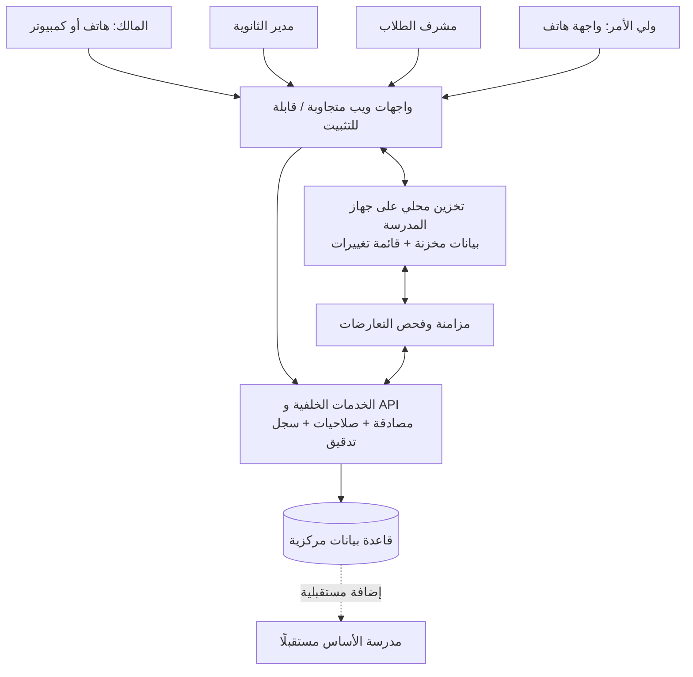
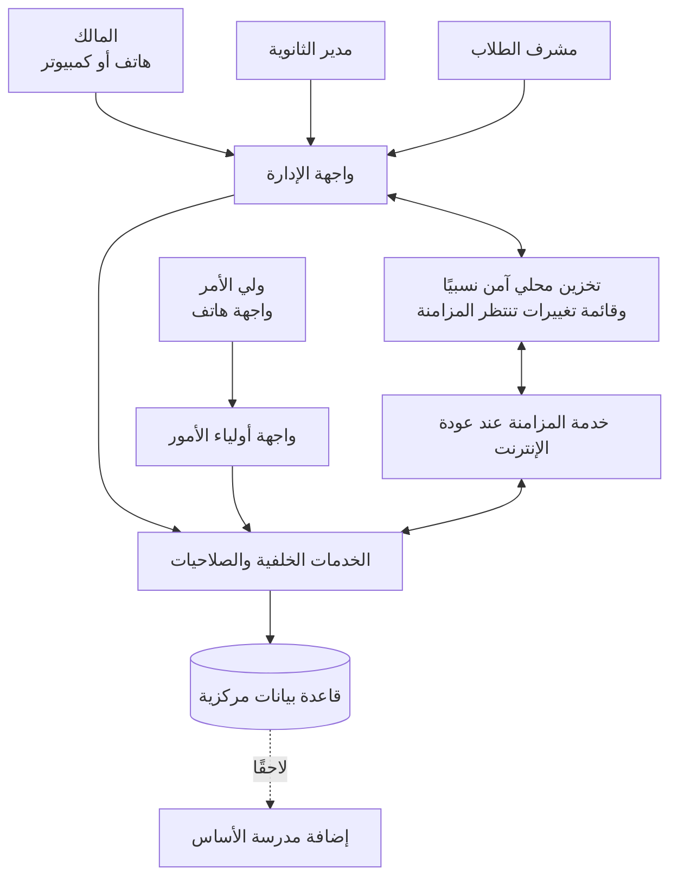
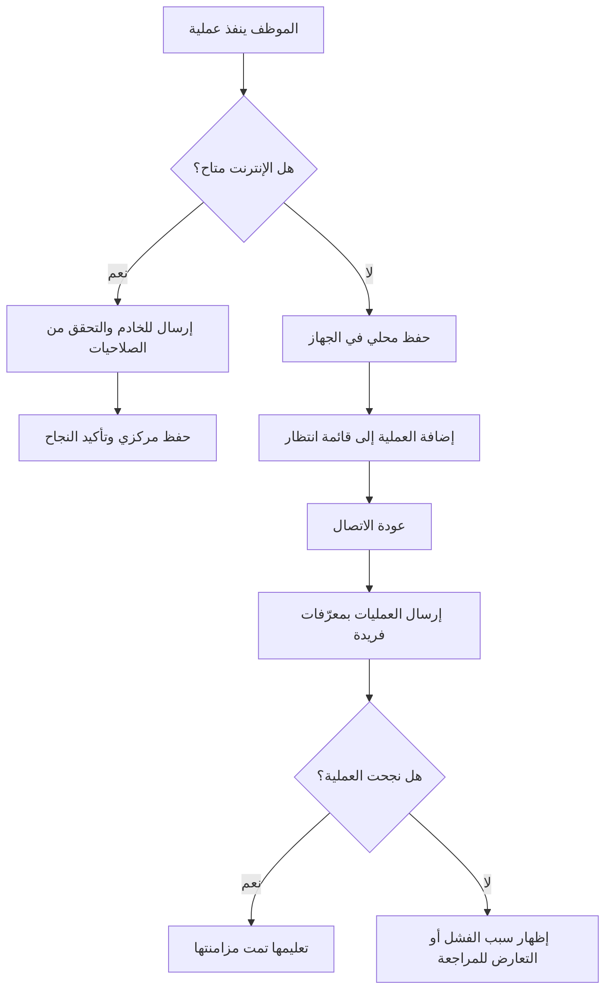

> [!NOTE]
> ??????? ??? ???????. ?????? ?????? ?????? ?? FIX-1 ? APP-2.

# نظام المدرسة: أسئلة للمدرسة وملاحظات التصميم

# 🏫 خطة نظام العمرابي المدرسي — المعمارية وخارطة التنفيذ

> هدف المشروع: بناء نظام مدرسي عملي يبدأ بمدرسة العمرابي الثانوية، مع تجهيز معماري يسمح بإضافة مدرسة الأساس مستقبلًا دون إعادة بناء النظام. هذه الصفحة هي المرجع الحالي للقرارات والخطة والمشكلات. عدّل البنود التي ما زالت مقترحات عند الحصول على إجابات من المالك والإدارة.

## 🚦 أين وصلنا؟

* المرحلة الحالية: تحديد المتطلبات وتجهيز نموذج أولي عبر Lovable.
* المدرسة المفعّلة عند البداية: العمرابي الثانوية فقط.
* مدرسة الأساس: خيار مستقبلي يجب ألا ننساه؛ لا ننفّذ وظائفها الآن ولا نفترض أنها بُنيت.
* هدف النموذج الأول: عرضه على المالك والمدير لاختبار سير العمل واكتشاف النواقص، باستخدام بيانات وهمية.
* قاعدة مهمة: لا تُعد أي ميزة جاهزة للإنتاج لمجرد أن واجهتها تعمل.

## 🧩 الفكرة ببساطة

المالك والمدير والمشرف يستخدمون واجهة إدارية واحدة تتكيف مع الكمبيوتر والهاتف. ولي الأمر يحصل على واجهة مخصصة له. الجميع يتعاملون مع خادم مركزي وقاعدة بيانات واحدة، مع صلاحيات تحدد ما يستطيع كل حساب رؤيته وتعديله.

## 🏗️ المعمارية المقترحة

| الجزء | وظيفته | الحالة |
| --- | --- | --- |
| Lovable | بناء واجهات الويب والنموذج التفاعلي | الاتجاه الحالي |
| واجهة الإدارة | المالك والمدير والمشرف، بواجهات تتكيف مع الجهاز | ضمن النطاق |
| واجهة ولي الأمر | الأبناء، النتائج، الحضور، الجداول، الأحداث والرسوم المسموح بها | مرحلة لاحقة |
| Supabase / PostgreSQL | قاعدة البيانات والمصادقة والخدمات اللازمة | مقترح؛ يجب التحقق من ملاءمته وتكلفته |
| API آمن | نقطة وصول مشتركة للعملاء والتحقق من الصلاحيات | مبدأ معماري مطلوب |
| PWA + IndexedDB | دعم فتح الواجهة والتخزين المحلي والعمل المحدود دون إنترنت | مطلوب تصميمه واختباره، وليس ميزة جاهزة تلقائيًا |
| نسخ احتياطية ومراقبة | استعادة البيانات واكتشاف الأعطال | شرط قبل التشغيل الحقيقي |

لا نحتاج إلى إنشاء تطبيق مستقل لكل موظف الآن. نبدأ بواجهة إدارية واحدة، وتظهر الوظائف بحسب صلاحيات الحساب. يمكن لاحقًا تغليفها كتطبيق أو بناء تطبيق Android أصلي إذا أثبت الاستخدام الحاجة إليه.

## 🏫 المدارس والبيانات

* كل مدرسة لها إعداداتها وصفوفها وشعبها وسنواتها الدراسية ومعلموها وموادها ونتائجها وحضورها ورسومها.
* يبدأ النظام بمدرسة الثانوية فقط؛ بنية البيانات تدعم إضافة مدرسة الأساس لاحقًا.
* المالك يستطيع مستقبلًا إدارة المدرستين من حساب واحد، أما المدير فلا يصل إلا إلى المدرسة والصلاحيات الممنوحة له.
* لا نضع اسم الثانوية أو صفوفها بصورة ثابتة داخل منطق البرنامج؛ تُدار المدارس والصفوف والشعب من البيانات والإعدادات.
* ملف الطالب منفصل عن تسجيله السنوي: الطالب شخص واحد، والتسجيل يحدد المدرسة والسنة والصف والشعبة والحالة.
* يحتفظ النظام بالتاريخ عند الترقية أو التخرج أو النقل أو الانقطاع؛ لا نحذف الطالب لإخفاء أنه غادر.
* يمكن أن يكون لولي الأمر حساب واحد يرى أبناءه المصرح له بهم، حتى لو درسوا في مدرستين مختلفتين مستقبلًا.

## 🎓 الهيكل الأولي للثانوية

* الصف الأول الثانوي: الشعب التي تحددها الإدارة.
* الصف الثاني الثانوي: الشعب التي تحددها الإدارة.
* الصف الثالث الثانوي: مساران، علمي وأدبي.
* المسار العلمي يتضمن التخصصات التي ذكرناها: أحياء، حاسوب، هندسية.
* نحتاج إلى تأكيد من المدرسة ما إذا كانت هذه الأسماء تمثل مسارات أم تخصصات أم شعبًا؛ لذا يجب أن تسمح البنية بتعديل التسلسل دون تغيير قاعدة البيانات جذريًا.
* الصفوف والشعب والمسارات والمواد قابلة للإضافة والتعديل، ولا تُحذف سجلات مرتبطة بها بطريقة تفسد التاريخ.

## 👥 المستخدمون والصلاحيات

| الدور | النطاق المتوقع |
| --- | --- |
| المالك | إعداد النظام وإدارة المدارس والمستخدمين والتقارير ضمن صلاحياته |
| مدير الثانوية | إدارة العمليات المصرح بها في الثانوية |
| مشرف الطلاب | شؤون الطلاب والحضور والوظائف المحددة له |
| المسؤول المالي | الرسوم والمدفوعات والتقارير المالية عند تفعيل هذا الدور |
| المعلم | وظيفة مستقبلية؛ إدخال ما يُسمح له من حضور ودرجات |
| ولي الأمر | عرض بيانات الأبناء المصرح بها فقط |

الأمان لا يعتمد على إخفاء الأزرار فقط. يجب فرض الصلاحيات على الخادم وقاعدة البيانات، مع HTTPS، وتخزين آمن لكلمات المرور، وتحديد محاولات الدخول، وتعطيل الحسابات بدل حذف تاريخها، وتسجيل العمليات المهمة في سجل تدقيق.

## 📡 العمل عند انقطاع الإنترنت

المطلوب: يبقى جهاز الإدارة قادرًا على تنفيذ بعض الأعمال عند انقطاع الشبكة، ثم يزامن التغييرات عند عودة الإنترنت.

### كيف ينبغي أن يعمل؟

1. أثناء الاتصال، يحمّل التطبيق البيانات اللازمة للعمل ويخزن نسخة محلية محدودة.
1. عند انقطاع الشبكة، يوضح التطبيق أنه غير متصل، ويسمح فقط بالعمليات التي صُممت للعمل محليًا.
1. تحفظ التغييرات في قائمة محلية بمعرّفات فريدة، وتظهر حالتها للمستخدم.
1. عند عودة الاتصال، تُرسل العمليات إلى الخادم مع منع تكرار العملية إذا أعيد إرسالها.
1. تُكتشف التعارضات بدل أن يكتب تغيير قديم فوق تغيير أحدث.
1. تعرض الواجهة: متصل، تغييرات بانتظار المزامنة، جارٍ التزامن، أو فشل يحتاج إلى مراجعة.

### قواعد السلامة

* لا نفترض أن كل بيانات النظام متاحة دون اتصال؛ المتاح هو ما سبق تخزينه محليًا.
* لا نعتبر التغييرات المحفوظة على الجهاز نسخة احتياطية آمنة من تعطل الجهاز أو فقدانه.
* الدفعات المالية والدرجات المعتمدة والترحيل السنوي تحتاج إلى قواعد أشد صرامة، ومعرّفات عمليات ثابتة ومراجعة التعارضات.
* يجب اختبار انقطاع الإنترنت فعليًا بعد النشر، بما في ذلك إغلاق المتصفح وإعادة فتحه، وإعادة الاتصال، وفشل المزامنة.
* إذا كان النظام غير جاهز للعمل المحلي، يجب توفير إجراء طوارئ واضح (مثل سجل ورقي ثم إدخال موثق بتاريخ الحدث) بدل الادعاء بأن العمل دون اتصال مضمون.

## 🗂️ الوظائف حسب الأولوية

### المرحلة 0 — اكتشاف المتطلبات

- [ ] مقابلة المالك ومدير الثانوية ومشرف الطلاب والمسؤول المالي.
- [ ] تأكيد الصلاحيات ومن يدخل البيانات ومن يعتمدها.
- [ ] تحديد الصفوف والشعب والمسارات والمواد ونظام الدرجات.
- [ ] تحديد الرسوم والأقساط والإيصالات والاستثناءات.
- [ ] الاتفاق على ملكية الكود والبيانات والدعم والتكلفة والمسؤولية.
- [ ] توثيق القرارات المؤكدة منفصلة عن الافتراضات.

### المرحلة 1 — تأسيس النظام

- [ ] إنشاء مشروع Lovable بهوية بصرية بسيطة ومتناسقة باللغة العربية وواجهة RTL.
- [ ] رسم نموذج البيانات والعلاقات قبل التوسع في الواجهات.
- [ ] إنشاء مدرسة الثانوية فقط وإعداد حساب المالك والمدير.
- [ ] تنفيذ المصادقة والصلاحيات الحقيقية وسجل التدقيق.
- [ ] إعداد بيئة اختبار وبيانات وهمية.

### المرحلة 2 — أساس الإدارة المدرسية

- [ ] إدارة الطلاب وملفاتهم.
- [ ] التسجيل السنوي وحالات الطالب: جديد لأول مرة، منقول من مدرسة أخرى، مستمر، متخرج، منتقل، منقطع، وغيرها وفق سياسة المدرسة.
- [ ] إدارة الصفوف والشعب والمسارات والسنوات الدراسية.
- [ ] إدارة المعلمين والمواد وإسناد المعلم للمادة والصف والشعبة.
- [ ] استيراد وتصدير البيانات مع التحقق من التكرار، دون دمج تلقائي اعتمادًا على الاسم وحده.

### المرحلة 3 — العمليات اليومية

- [ ] الحضور: الأصل حاضر، ويسجل الموظف الاستثناءات فقط.
- [ ] حالات قابلة للتكوين مثل غائب بعذر، غائب دون عذر، متأخر، خرج بإذن.
- [ ] آلية مراجعة قبل إرسال إشعار الغياب لتقليل الإشعارات الخاطئة.
- [ ] الامتحانات والدرجات والمسودات والاعتماد والنشر.
- [ ] الجداول ومنع تعارضات المعلمين والحصص.
- [ ] تقارير الطلاب والحضور والنتائج وتصدير PDF وExcel.

### المرحلة 4 — الرسوم والمالية

- [ ] تعريف الرسوم حسب السنة والصف ونوع الرسم ومواعيد الاستحقاق.
- [ ] تثبيت المستحقات على تسجيل الطالب السنوي حتى لا يغير تعديل الأسعار سجلات السنوات السابقة.
- [ ] دعم المنح والخصومات المرتبطة بالتسجيل السنوي.
- [ ] حساب الرصيد من المستحقات والخصومات والمدفوعات؛ لا نخزن رصيدًا يدويًا باعتباره الحقيقة.
- [ ] عدم حذف أو تعديل القيود المالية المحفوظة؛ التصحيح بقيد عكسي موثق.
- [ ] إيصالات وتقارير مالية وصلاحيات وصول واضحة.

### المرحلة 5 — تجربة ولي الأمر

- [ ] حساب واحد لولي الأمر مع إمكانية ربط عدة أبناء.
- [ ] عرض بيانات الأبناء الذين يحق له الاطلاع عليهم فقط.
- [ ] النتائج والجداول والحضور والأحداث والإعلانات.
- [ ] الرسوم فقط لمن لديه صلاحية رؤيتها.
- [ ] الإشعارات بعد اختبار صحة البيانات وسيناريوهات الفشل.
- [ ] عدم عرض السجل المرضي الحساس في الإصدار الأول.

### المرحلة 6 — المزامنة والاستعداد للتشغيل

- [ ] تنفيذ PWA والتخزين المحلي وقائمة التغييرات.
- [ ] اختبار منع التكرار والتعارضات وفشل الاتصال.
- [ ] إعداد النسخ الاحتياطي اليومي واختبار الاستعادة فعليًا.
- [ ] مراقبة الأخطاء وتوافر الخادم.
- [ ] تجربة على فصل واحد لمدة شهر وتدريب الموظفين قبل التعميم.

### المرحلة 7 — توسعات مستقبلية

- [ ] إضافة مدرسة الأساس من الإعدادات وبإعدادات أكاديمية مستقلة.
- [ ] إضافة تطبيق Android أصلي إذا احتاج المستخدمون إليه.
- [ ] ترحيل جماعي للطلاب نهاية العام بعد اعتماد النتائج.
- [ ] اجتماعات وسجل مرضي محدود الوصول وملاحظات سلوك وواجبات عند اعتمادها.

## 🖼️ الرسومات والصور

استخدم مخطط Mermaid أعلاه لفهم العلاقات والتدفق؛ يمكن تعديل عقده وأسهمه بسهولة عند تغير القرار. ويمكن إضافة صور للشاشات التجريبية أو لقطات من Lovable هنا لاحقًا. لا نحتاج إلى صور زخرفية كثيرة؛ الأفضل أن تخدم فهم النظام. إذا أُضيفت صورة، اكتب تحتها ما الذي توضحه وما الذي لم يُنفذ بعد.

## 🧯 سجل المشكلات والمخاطر

سجّل كل مشكلة جديدة بهذا النموذج، وغيّر الحالة عند حلها. لا تعتبر المشكلة محلولة إلا بعد اختبار ذلك.

| المعرّف | المشكلة أو الخطر | الأثر | الأولوية | الحالة | الخطوة التالية |
| --- | --- | --- | --- | --- | --- |
| R-01 | المتطلبات الفعلية للمدرسة غير مكتملة | إعادة بناء أجزاء من النظام | عالية | مفتوحة | مقابلة الإدارة وتوثيق الإجابات |
| R-02 | ملكية الكود والبيانات وتكاليف التشغيل غير محسومة | خلافات أو تكاليف غير متوقعة | عالية | مفتوحة | اتفاق واضح قبل التشغيل |
| R-03 | صلاحيات الواجهة وحدها لا تحمي البيانات | كشف بيانات الطلاب | حرجة | مفتوحة | فرض الصلاحيات على الخادم وقاعدة البيانات واختبارها |
| R-04 | مزامنة دون اتصال قد تكرر عملية أو تفقد تغييرًا | خطأ مالي أو أكاديمي | حرجة | تصميم مطلوب | معرّفات ثابتة، منع التكرار، كشف التعارضات واختبارها |
| R-05 | تعطل جهاز المدرسة قبل المزامنة | فقد تغييرات محلية | عالية | مفتوحة | تحديد سياسة نسخ محلي وطوارئ |
| R-06 | تكلفة الاستضافة والرسائل قد تتجاوز الميزانية | توقف الخدمة | عالية | مفتوحة | مقارنة التكلفة الفعلية وخطة الخروج |
| R-07 | إشعار غياب خاطئ | إزعاج ولي الأمر وفقد الثقة | متوسطة | مفتوحة | مراجعة/مهلة قبل الإرسال |
| R-08 | تكرار ملف الطالب أو ولي الأمر | بيانات متضاربة | عالية | مفتوحة | مطابقة حذرة والتحقق قبل الدمج |
| R-09 | تعديل الرسوم قد يغير ديون سنوات سابقة | فساد السجلات المالية | حرجة | تصميم مطلوب | تثبيت المستحقات على التسجيل السنوي |
| R-10 | إضافة الأساس مستقبلًا تتطلب تغييرات كبيرة | تكلفة إعادة بناء | عالية | تصميم مطلوب | جعل المدارس والإعدادات والصفوف بيانات قابلة للتكوين |

### طريقة إدارة المشكلات

* مفتوحة: لم يُعثر على حل أو لم يُختبر بعد.
* قيد العمل: يجري تنفيذ الحل.
* بانتظار قرار: تحتاج إجابة من المالك أو الإدارة.
* محلولة ومختبرة: تم الإصلاح واختباره، مع تدوين طريقة التحقق.
* مؤجلة: لا تمنع المرحلة الحالية، لكن يجب تحديد موعد أو شرط لإعادتها.

## ❓ القرارات والأسئلة التي لا تزال مفتوحة

- [ ] من يملك الكود والبيانات؟ ومن يدفع الاستضافة والدعم؟
- [ ] ما الميزانية الشهرية المتاحة؟
- [ ] ما حجم المدرسة المتوقع وعدد الطلاب والشعب؟
- [ ] من يسجل الحضور والدرجات، ومن يعتمد النتائج؟
- [ ] ما التقويم المعتمد وما نظام الدرجات وشكل الشهادة؟
- [ ] ما أنواع الرسوم والأقساط والخصومات، وهل حسابات المدرستين منفصلة ماليًا مستقبلًا؟
- [ ] من يحق له رؤية رسوم الطالب؟ ومن يستلم إشعارات الغياب؟
- [ ] ما سياسة التعامل مع تعارض البيانات أثناء المزامنة؟
- [ ] ما العمليات التي يجب أن تعمل دون إنترنت في الإصدار الأول؟
- [ ] ما متطلبات الخصوصية المحلية ومدة الاحتفاظ بالسجلات؟

## 📌 قواعد تمنع تشتت المشروع

1. لا نبني كل شيء في Prompt واحد ضخم.
1. ننفذ مرحلة صغيرة، نختبرها، ثم ننتقل إلى التالية.
1. نميز دائمًا بين قرار مؤكد واقتراح وسؤال مفتوح.
1. لا نستخدم بيانات طلاب حقيقية في النموذج الأولي.
1. لا نربط الواجهة مباشرة بقاعدة البيانات بصلاحيات واسعة.
1. لا نعلن جاهزية العمل دون اتصال قبل اختباره فعليًا.
1. نحتفظ بنسخ احتياطية ونختبر الاستعادة، لا مجرد إنشاء النسخة.
1. نضيف مدرسة الأساس لاحقًا كمدرسة جديدة ضمن المعمارية نفسها، لا كمشروع منفصل.
1. بعد كل جلسة مع المالك، حدّث سجل القرارات والمشكلات بدل الاعتماد على الذاكرة.

## ▶️ الخطوة التالية

ابدأ برسم مخطط قاعدة البيانات والعلاقات الأساسية، ثم راجعها قبل تنفيذها في Lovable. بعد ذلك نبني تسجيل الدخول والصلاحيات ولوحة المالك ومدير الثانوية، ثم نضيف وظائف الطلاب تدريجيًا.

هذه الخطة قابلة للتعديل: غيّر حالة أي بند، وأضف الأسئلة أو المشكلات التي تظهر أثناء التجربة. عندما يتغير قرار معماري، حدّث قسم المعمارية وسجّل سبب التغيير حتى لا تتعارض أجزاء الخطة.

# 🧭 الخطة الحالية — نسخة عمل 19 أكتوبر 2026

> الفكرة ببساطة: نبني نظام العمرابي للثانوية أولًا، لكن نضع أساسًا يسمح بإضافة مدرسة الأساس مستقبلًا. المالك والمديرون والمشرفون يستخدمون واجهة إدارية واحدة من الكمبيوتر أو الهاتف، وولي الأمر يحصل على واجهة مناسبة للهاتف. البيانات مركزية، وجهاز المدرسة يستطيع متابعة بعض الأعمال عند انقطاع الإنترنت ثم مزامنتها عند عودته.

> قاعدة إدارة المشروع: هذه الصفحة هي خريطة الطريق الحية. يمكن تعديل القرارات في أي وقت. كل نقطة تحمل حالة واضحة: متفق عليه، مقترح، أو يحتاج قرارًا. لا نحول الاقتراح إلى قرار نهائي من دون مراجعة.

## 1. صورة المشروع في دقيقة واحدة

* الآن: مدرسة العمرابي الثانوية فقط.
* لاحقًا: إضافة مدرسة الأساس من دون إنشاء نظام منفصل أو إعادة بناء الأساس.
* من أي مكان: المالك يستطيع الدخول من هاتفه أو الكمبيوتر عبر الإنترنت.
* عند انقطاع الإنترنت: يعمل جهاز المدرسة على البيانات التي سبق تجهيزها محليًا والعمليات التي يسمح بها وضع عدم الاتصال؛ ثم يزامن التغييرات عند عودة الشبكة.
* مهم: لا نعتبر أي تغيير محفوظًا مركزيًا حتى يؤكد النظام نجاح مزامنته.

## 2. القرارات الحالية

| الموضوع | الحالة | القرار أو التوضيح |
| --- | --- | --- |
| بدء التنفيذ | متفق عليه | نبدأ بالثانوية |
| مدرسة الأساس | متفق عليه | احتمال بعيد المدى؛ يجب أن تدعمه المعمارية ولا ننفذ وظائفها الآن |
| واجهة الإدارة | متفق عليه مبدئيًا | واجهة واحدة للمالك والمدير والمشرف، تتغير وظائفها حسب الصلاحيات |
| الهاتف والكمبيوتر | متفق عليه | تصميم متجاوب، مع بحث خيار التثبيت كتطبيق ويب PWA |
| تطبيق ولي الأمر | ضمن الخطة | واجهة منفصلة في تجربة الاستخدام، تشترك في قاعدة البيانات والخدمات الخلفية |
| الخادم | متفق عليه | مركزي عبر الإنترنت؛ لا نفترض وجود خادم محلي في المدرسة |
| العمل دون اتصال | مطلوب | جهاز الإدارة يحتفظ بالتغييرات محليًا ويزامنها لاحقًا |
| قاعدة البيانات | مقترح قوي | PostgreSQL عبر Supabase بعد التحقق من ملاءمة الخطة والتكلفة |
| أداة بناء الواجهات | الاتجاه الحالي | Lovable للنموذج الأول والتطوير التدريجي |
| تطبيق Android أصلي للإدارة | غير محسوم | لا نبنيه الآن؛ نختبر واجهة الويب أولًا |
| الصناديق المالية للمدرستين مستقبلًا | يحتاج قرارًا | هل ستكون مشتركة أم مستقلة؟ |
| ملكية الكود والبيانات والدعم | يحتاج اتفاقًا | توضيحها مع المالك قبل التشغيل الحقيقي |

## 3. كيف يتوزع النظام؟

### أ. واجهة الإدارة

واجهة واحدة تتكيف مع الشاشة، وتعرض لكل حساب الوظائف المسموح بها:

* المالك: مؤشرات عامة، متابعة المدرسة، التقارير، إدارة المستخدمين والصلاحيات، ثم إدارة المدرستين عند إضافة الأساس.
* مدير الثانوية: شؤون الطلاب والصفوف والشعب والمعلمين والحضور والنتائج والجداول والرسوم وفق الصلاحيات.
* مشرف الطلاب: الوظائف المحددة له، مثل ملفات الطلاب والحضور، دون فتح أقسام لا تخص عمله.
* مسؤول مالي أو موظفون آخرون: يمكن إضافتهم لاحقًا بصلاحيات مستقلة بدل إنشاء تطبيق كامل جديد لكل وظيفة.

### ب. واجهة ولي الأمر

تجربة استخدام مخصصة للهاتف تشمل:

* الأبناء المسجلين المرتبطين بحسابه.
* النتائج المنشورة فقط.
* جدول الحصص والتقويم والأحداث.
* الحضور والغياب والإشعارات.
* الرسوم والمدفوعات، إذا كانت لديه صلاحية الاطلاع عليها.
* إمكانية رؤية الأبناء في المدرستين مستقبلًا من حساب واحد.

### ج. الخدمات الخلفية وقاعدة البيانات

كل الواجهات تتصل بالخدمات الخلفية نفسها. لا يتصل تطبيق المستخدم بقاعدة البيانات بصلاحيات مفتوحة. تُفرض الصلاحيات في الخادم وقواعد الوصول إلى البيانات، وليس بمجرد إخفاء الأزرار.

## 4. المعمارية التي نريدها

* واجهة المستخدم: Lovable لتطوير تطبيق ويب متجاوب، مع اختبار إمكان تثبيته كتطبيق PWA.
* الخدمات الخلفية: عمليات التحقق من الصلاحيات، قواعد العمل، التسجيلات، الحضور، النتائج والرسوم.
* قاعدة البيانات: PostgreSQL، مع Supabase كخيار مقترح للمصادقة وقاعدة البيانات والخدمات اللازمة.
* API بإصدار واضح: مثل /api/v1/ إذا احتجنا واجهة API مستقلة؛ حتى يمكن ربط تطبيق Android أو برنامج سطح مكتب مستقبلًا دون الوصول المباشر إلى قاعدة البيانات.
* النسخ الاحتياطي: نسخ منتظمة واختبار استعادة حقيقي قبل التشغيل.
* الأمان: HTTPS، كلمات مرور مجزأة آمنًا، صلاحيات خادمية، سجل تدقيق، تحديد محاولات الدخول، وتعطيل الحسابات بدل حذفها.
* قابلية النقل: الاحتفاظ بالكود وفهم مخطط قاعدة البيانات، وتجنب اعتماد لا يمكن تحمل تكلفته أو الخروج منه.

> تنبيه تقني: Lovable لا يجعل النظام آمنًا أو يعمل دون اتصال تلقائيًا. هذه وظائف يجب تصميمها وتنفيذها واختبارها. ولا تُدخل بيانات طلاب حقيقية قبل اختبار الصلاحيات والحماية والنسخ الاحتياطي.

## 5. الهيكل الأكاديمي للثانوية

الصفوف والشعب والمسارات بيانات قابلة للإدارة من الواجهة، وليست أسماء ثابتة داخل الكود.

* الصف الأول الثانوي: شعب تنشئها الإدارة.
* الصف الثاني الثانوي: شعب تنشئها الإدارة.
* الصف الثالث الثانوي:
  * المسار العلمي: أحياء، حاسوب، هندسية.
  * المسار الأدبي: شعبه وفق تنظيم المدرسة.
يجب ألا نفترض أن الصف والمسار والشعبة شيء واحد. نصمم علاقاتها بمرونة حتى يمكن إضافة أنظمة صفوف مختلفة لمدرسة الأساس مستقبلًا.

## 6. قاعدة بيانات تحافظ على تاريخ الطالب

القاعدة الأساسية: ملف الشخص منفصل عن تسجيله المدرسي السنوي.

* ملف الطالب يحتفظ ببياناته الأساسية.
* التسجيل يحدد المدرسة والسنة والصف والشعبة وحالة الطالب في تلك السنة.
* النتائج والحضور والرسوم ترتبط بالتسجيل المناسب، لا بمجرد ملف الطالب.
* لا نحذف الطالب عند انتقاله أو تخرجه؛ نحتفظ بسجلاته التاريخية ونحدّث الحالة.
* الطالب القادم من مدرسة خارج النظام يمكن تسجيله كـ«منقول من مدرسة أخرى» مع حفظ المدرسة السابقة إن توفرت، دون اشتراط وجود سجل سابق في نظامنا.
* نميز بين «منقول»، و«جديد لأول مرة»، و«مستمر» بدل افتراض أن كل طالب مستمر.
* نهاية السنة: ترقية جماعية بعد مراجعة النتائج والحالات الاستثنائية، مع منع تكرار الترحيل إذا أعيدت العملية.
* يمكن للطالب نفسه أن ينتقل لاحقًا من الأساس إلى الثانوية، مع الحفاظ على ملف واحد وتسجيلات منفصلة.

## 7. الطلاب وأولياء الأمور والصلاحيات

* حساب ولي أمر واحد يمكنه متابعة أكثر من ابن.
* جدول ربط بين ولي الأمر والطالب يحدد صلة القرابة، وجهة الاتصال الأساسية، واستلام الإشعارات، وحق استلام الطالب، وإمكانية رؤية الرسوم.
* نبحث عن ولي الأمر برقم الهاتف قبل إنشاء سجل جديد لتقليل التكرار، مع عدم الدمج التلقائي اعتمادًا على الاسم وحده.
* صلاحيات الموظف مرتبطة بالمدرسة والوظائف المسموح بها.
* المالك يستطيع الوصول إلى المدرستين مستقبلًا؛ مدير الثانوية لا يحصل تلقائيًا على بيانات الأساس.
* تعطيل وصول ولي الأمر أو الموظف لا يعني حذف السجلات التاريخية.
* السجل الطبي والحالات الخاصة بيانات حساسة، ولا تظهر لولي الأمر أو الموظفين إلا وفق سياسة صريحة ومحددة.

## 8. الحضور والدرجات والجداول

### الحضور

* الوضع الافتراضي أن الطلاب حاضرون، ويسجل الموظف الاستثناءات فقط.
* الحالات الأولية: غائب بعذر، غائب دون عذر، متأخر، خرج بإذن. يمكن تعديل القائمة لاحقًا.
* نحدد من يسجل الحضور، ومن يراجع السجل، وهل توجد مهلة لمراجعة الغياب قبل إرسال الإشعار.
* عند العمل دون اتصال، يجب أن تظهر حالة التغيير بوضوح: محفوظ محليًا، ينتظر المزامنة، تمت المزامنة، أو يحتاج معالجة.

### الدرجات

* المواد ترتبط بالصف أو المسار والشعبة والسنة والمعلم.
* الامتحانات وسلالم الدرجات قابلة للضبط حسب سياسة المدرسة.
* النتيجة تكون «مسودة» ثم «منشورة»؛ لا يراها ولي الأمر قبل النشر.
* تعديل نتيجة منشورة يحتاج صلاحية وسجلًا يوضح من عدّلها ومتى ولماذا.

### الجداول والأحداث

* جداول حصص حسب الصف والشعبة والمعلم والمادة.
* اكتشاف تعارض المعلم أو الحصة متى أمكن.
* تقويم للأحداث والاجتماعات والإعلانات العامة أو الموجهة لصف معين.

## 9. الرسوم والسجلات المالية

* الرسوم قابلة للتحديد حسب السنة والصف ونوع الرسم.
* عند تسجيل الطالب، تُنشأ له مستحقات تلك السنة من إعدادات الرسوم؛ تعديل أسعار سنة لاحقة لا يغيّر السجلات القديمة.
* الرصيد يُحسب من المستحقات ناقص الخصومات والمنح والمدفوعات المخصصة، ولا نخزنه كرقم قد يصبح قديمًا.
* المنح والخصومات ترتبط بالتسجيل السنوي، ولا تنتقل تلقائيًا إلى السنة التالية.
* بعد حفظ قيد مالي، لا نعدّله أو نحذفه بصمت؛ نصحح الخطأ بقيد عكسي مع السبب.
* يمكن أن يدفع ولي الأمر لأكثر من ابن، لكن يجب أن يكون توزيع المبلغ على حساب كل ابن واضحًا.
* الدفع الإلكتروني ليس شرطًا للإصدار الأول؛ يمكن البدء بتسجيل المدفوعات التي تستلمها المدرسة وإصدار إيصالات.
* يجب حسم ما إذا كانت مالية المدرستين مشتركة أم مستقلة قبل تفعيل مدرسة الأساس.

## 10. العمل دون اتصال والمزامنة

قواعد لا بد منها:

* نستخدم تخزينًا محليًا مثل IndexedDB وقائمة انتظار للمزامنة، مع تخزين أقل قدر لازم من البيانات.
* لكل عملية معرّف فريد يمنع تسجيلها مرتين عند إعادة الإرسال.
* نكتشف التعارض إذا تغير السجل على الخادم منذ آخر تنزيل؛ لا نسمح لتغيير قديم بمحو تغيير أحدث دون مراجعة.
* العمليات المالية وتعديل النتائج المنشورة والترحيل السنوي تحتاج قواعد أشد، وقد تُمنع دون اتصال أو تتطلب اعتمادًا عند عودة الشبكة.
* نعرض حالة المزامنة للمستخدم دائمًا.
* إذا تعطل الجهاز قبل مزامنة التغييرات، قد تُفقد تلك التغييرات؛ لذلك لا بد من توضيح هذا الخطر وإجراءات النسخ الاحتياطي.
* يجب اختبار انقطاع الشبكة فعليًا بعد النشر، وليس الاكتفاء بمحاكاة واجهة «غير متصل».

## 11. مراحل البناء

- [ ] المرحلة 0 — تثبيت المتطلبات: مراجعة هذه الصفحة، وحسم الأسئلة الحرجة مع المالك.
- [ ] المرحلة 1 — تأسيس النظام: مشروع Lovable، قاعدة البيانات، تسجيل الدخول، المدارس، المستخدمون والصلاحيات.
- [ ] المرحلة 2 — بيانات الثانوية: الطلاب، التسجيل السنوي، الصفوف والشعب، المعلمون والمواد.
- [ ] المرحلة 3 — العمليات اليومية: الحضور، الامتحانات، النتائج والجداول.
- [ ] المرحلة 4 — المالية والتقارير: المستحقات، الدفعات، الخصومات، الإيصالات والتصدير.
- [ ] المرحلة 5 — ولي الأمر: واجهة الهاتف، الأبناء، النتائج المنشورة، الحضور والجداول والإشعارات.
- [ ] المرحلة 6 — العمل دون اتصال: يبدأ بنطاق صغير وآمن، مثل تسجيل الحضور، ثم يتوسع بعد اختبارات المزامنة.
- [ ] المرحلة 7 — التجربة: تجربة على فصل واحد لمدة مناسبة، تدريب الموظفين، تسجيل الملاحظات وإصلاحها.
- [ ] المرحلة 8 — التشغيل الحقيقي: بعد اختبار الصلاحيات، النسخ الاحتياطي والاستعادة، والمزامنة، وتحديد المسؤوليات والتكلفة.
- [ ] مستقبلًا — مدرسة الأساس: تفعيل مدرسة جديدة وإعداد صفوفها ورسومها وصلاحياتها دون إعادة بناء النظام.

## 12. سجل المشكلات والمخاطر

هذا القسم مخصص للمشكلات الفعلية والأسئلة التي لم تُحسم. نضيف كل مشكلة مع أثرها وخطوة معالجتها؛ لا نخفيها داخل الملاحظات العامة.

| المشكلة أو الخطر | الأثر | الحالة | الإجراء التالي |
| --- | --- | --- | --- |
| متطلبات المدرسة لم تُحسم كلها | إعادة بناء وظائف بعد التنفيذ | مفتوح | مقابلة المالك والمدير والمشرف والمسؤول المالي |
| ملكية الكود والبيانات والدعم غير محددة | خلافات ومسؤولية غير واضحة | مفتوح | اتفاق مكتوب قبل التشغيل الحقيقي |
| تكلفة الاستضافة والخدمات غير مؤكدة | تعطل المشروع أو ارتفاع التكلفة | مفتوح | مقارنة التكلفة الفعلية وخطط النقل |
| المزامنة دون اتصال معقدة | فقدان أو تكرار البيانات | خطر تقني | تنفيذ تدريجي واختبارات انقطاع وتعافٍ |
| تعارض تعديلات المستخدمين | استبدال تغيير صحيح بآخر قديم | خطر تقني | إصدار/توقيت للسجلات وقواعد تعارض |
| حماية بيانات الطلاب | كشف بيانات أو وصول غير مصرح | خطر حرج | مراجعة الصلاحيات والسياسات واختبارها |
| نسخ احتياطي لم تُختبر استعادته | فقدان بيانات عند العطل | مفتوح | اختبار استعادة موثق قبل التشغيل |
| غموض إجراءات الرسوم والمنح | أرصدة وتقارير خاطئة | مفتوح | اعتماد قواعد مالية مكتوبة من المدرسة |
| طريقة اعتماد النتائج غير محددة | نشر نتائج غير مراجعة | مفتوح | تحديد من يدخل ومن يراجع ومن ينشر |
| الإشعارات قد تكون خاطئة أو لا تصل | إرباك أولياء الأمور | مفتوح | تأكيد قبل الإرسال وسجل لحالة الإشعار |
| مدرسة الأساس لم تُبنَ بعد | اختلاف متطلبات المرحلة | مؤجل | الحفاظ على معمارية متعددة المدارس وعدم تنفيذ وظائفها الآن |

### قالب إضافة مشكلة جديدة

انسخ هذا القالب كلما اكتشفت مشكلة:

* عنوان المشكلة:
* ما الذي حدث أو ما الذي لا نعرفه؟
* من المتأثر؟
* الأثر إذا لم نعالجها:
* الحالة: مفتوحة / قيد الحل / تنتظر قرارًا / محلولة.
* القرار أو الحل المقترح:
* من يجب أن يؤكد الحل؟
* تاريخ المراجعة:

## 13. أسئلة تحتاج إلى إجابة قبل التشغيل الحقيقي

- [ ] من يملك الكود والبيانات؟ ومن يتحمل الصيانة والدعم وتكلفتهما؟
- [ ] ما التكلفة الشهرية المقبولة للاستضافة والإشعارات؟
- [ ] من يستخدم النظام فعليًا، وما الأجهزة المتاحة؟
- [ ] من يسجل الحضور والدرجات؟ ومن يعتمدها وينشرها؟
- [ ] ما أنواع الرسوم ومواعيدها والخصومات والمنح؟
- [ ] من يحق له رؤية رسوم الأسرة والسجل الطبي والحالات الخاصة؟
- [ ] ما سياسة المدرسة عند تعطل الجهاز أو انقطاع الشبكة طويلًا؟
- [ ] ما التقارير التي يحتاجها المالك والمدير والمسؤول المالي؟
- [ ] ما إجراءات نقل الطالب أو انسحابه أو تخرجه؟
- [ ] ما سياسة الاحتفاظ ببيانات الطلاب وموافقة أولياء الأمور وفق القواعد المحلية؟

## 14. طريقة استخدام هذه الصفحة

* غيّر أي قرار عندما تظهر معلومات جديدة، وسجّل سبب التغيير وتاريخه.
* استخدم متفق عليه / مقترح / يحتاج قرارًا / مؤجلًا لتمييز درجة الحسم.
* لا تنتقل إلى مرحلة كبيرة قبل اختبار المرحلة الحالية.
* عند عرض النموذج على المالك، دوّن ملاحظاته في سجل المشكلات بدل إجراء تعديلات عشوائية.
* لا تستخدم بيانات طلاب حقيقية في النموذج الأولي.
* اجعل هذه الصفحة مرجع المشروع، ثم أنشئ صفحات فرعية عند الحاجة للتفاصيل الكبيرة، مثل مخطط قاعدة البيانات، خطة الاختبار، أو سجل القرارات.

> أقرب خطوة عملية: لا نبدأ بكل الوظائف. نراجع أسئلة الاتفاق مع المدرسة، ثم نرسم مخطط قاعدة البيانات ونثبت نموذج الصلاحيات، وبعدها نبني المرحلة الأولى في Lovable ونختبرها.

---

# الأرشيف السابق

تظل الأقسام القديمة في هذه الصفحة مرجعًا للأسئلة والملاحظات التي جُمعت سابقًا. إذا تعارضت ملاحظة قديمة مع الخطة الحالية أعلاه، نراجعها ونحدّثها بدل اعتمادها تلقائيًا.

> لا تبدأ البناء قبل الحصول على إجابات الأقسام 1 و2 و6 على الأقل، فهي تحدد البنية والصلاحيات والمسؤولية.

# 1. الاتفاق مع المدرسة (الأهم)

- [ ] من يملك الكود ومن يملك البيانات؟
- [ ] من يتولى الصيانة والدعم الفني، وبأي مقابل؟
- [ ] ما التكلفة الشهرية للسيرفر والإشعارات، ومن يدفعها؟
- [ ] من المسؤول إذا تسرّبت بيانات طلاب أو ضاع سجل مالي؟
- [ ] هل سيُكتب اتفاق رسمي يحدد ذلك؟

# 2. البنية التقنية

- [ ] هل الإنترنت في مكتب المدرسة مستقر طوال الدوام؟
- [ ] كم جهازاً سيستخدم النظام ومن يستخدمه؟
- [ ] ماذا يفعل الموظف إذا توقف النظام وقت التحضير؟ (ورقة بديلة ثم إدخال متأخر بتاريخ سابق)
- [ ] من يتحمل مسؤولية النسخ الاحتياطي واختبار الاستعادة؟

# 3. المراحل والصفوف

- [ ] ما مراحل المدرسة (ابتدائي، متوسط، ثانوي)؟
- [ ] أي صف هو الأخير في كل مرحلة (التخرج)؟
- [ ] كم شعبة لكل صف، وكم طالباً متوقعاً؟
- [ ] هل يدخل الطلاب الجدد في صفوف متوسطة أو أخيرة؟ وما الوثائق المطلوبة منهم (شهادة نقل، المدرسة السابقة)؟
- [ ] التقويم المعتمد: هجري أم ميلادي أم الاثنان؟

# 4. الحالات الخاصة والمنح

- [ ] ما هي الحالات الخاصة تحديداً؟ (احتياجات تعليمية، ظروف أسرية، يتيم، استثناءات رسوم...)
- [ ] من يحق له الاطلاع على كل نوع منها؟
- [ ] هل تؤثر على من يستلم الإشعار أو من يحق له استلام الطالب؟
- [ ] أنواع المنح: كاملة، جزئية، إعفاء؟
- [ ] هل المنحة بنسبة أم بمبلغ؟ ومن الجهة الداعمة؟
- [ ] شروط الاستمرار في المنحة وتجديدها كل سنة؟

# 5. الرسوم

- [ ] هل الرسوم حسب الصف أم حسب السنة أم مبلغ ثابت للجميع؟
- [ ] أنواع الرسوم: دراسة، تسجيل، كتب، نقل، زي...؟
- [ ] هل تُدفع دفعة واحدة أم أقساط؟ وما مواعيد الاستحقاق؟
- [ ] هل تُدفع بعملة واحدة؟ وهل تتغير الأسعار خلال السنة؟ (إن كان نعم نخزّن العملة مع كل قيد)
- [ ] هل يوجد خصم للإخوة؟
- [ ] ماذا يحدث لنتائج الطالب أو شهادته إذا كان عليه دين؟ (قرار المدرسة وليس قراري)
- [ ] من يستلم المدفوعات ويصدر الإيصالات؟
- [ ] هل الدفع يبقى في المدرسة وليس إلكترونياً؟

# 6. الأولياء والخصوصية

- [ ] من يحق له رؤية الرسوم من أولياء الأمور؟
- [ ] ماذا يحدث عند تغيير رقم الهاتف أو ضياع الهاتف؟
- [ ] ما البديل إذا لم يصل الإشعار؟ (رسالة SMS مكلفة)
- [ ] هل المدرسة تأخذ موافقة الأولياء على جمع بياناتهم وبيانات أبنائهم؟
- [ ] ما اللوائح المحلية أو توجيهات الوزارة بشأن بيانات الطلاب؟
- [ ] مدة الاحتفاظ بسجلات الخريجين، وخاصة السجلات الطبية والمالية؟
- [ ] من يحق له الاطلاع على السجل المرضي؟

# 7. الحضور والدرجات والجداول

- [ ] من يسجل الحضور: الإدارة أم المعلمون؟
- [ ] الحالات: حاضر، غائب، متأخر، غياب بعذر؟
- [ ] مدة التراجع قبل إرسال إشعار الغياب (مثلاً 5 دقائق)؟
- [ ] من يدخل الدرجات؟ وهل تحتاج موافقة قبل ظهورها للأولياء؟
- [ ] سلم التقدير والمواد والامتحانات وشكل شهادة النتائج؟
- [ ] بيانات المعلمين، وإسنادهم للمواد والصفوف، ومنع تعارض الجدول؟
- [ ] الاجتماعات: من ينظمها وكيف يُبلَّغ بها الأولياء؟
- [ ] ما التقارير التي تحتاجها الإدارة (حضور، مالية، نتائج)؟

# 8. التشغيل والتدريب

- [ ] تجربة النظام على فصل واحد لمدة شهر قبل التعميم
- [ ] جلسة تدريب لكل موظف
- [ ] طريقة تسليم حسابات الأولياء حضورياً (اسم مستخدم وكلمة مرور مؤقتة تُغيَّر عند أول دخول)

---

# قرارات التصميم والملاحظات

## البنية

* سيرفر مركزي واحد وقاعدة بيانات واحدة (PostgreSQL). نظام الموظفين وتطبيق الأولياء والموقع كلها عملاء لنفس الـ API. [Likely]
* نظام الموظفين (PyQt6) يتصل عبر الـ API وليس بقاعدة البيانات مباشرة، لنتحكم بالصلاحيات وسجل التدقيق. [Likely]
* مسارات API بإصدار (/api/v1/) حتى لا تنكسر التطبيقات القديمة. [Confirmed]
* استضافة Render المجانية تنام بعد الخمول، لذا نحتاج خطة مدفوعة أو VPS لمدرسة حقيقية. [Likely]
* نسخ احتياطي يومي واختبار استعادة فعلي قبل التشغيل. [Confirmed]

## بنية البيانات

* جدول الطلاب فيه البيانات الثابتة فقط. الصف والسنة في جدول التسجيل السنوي (Enrollment). لا تخزّن الصف داخل جدول الطالب. [Confirmed]
* لا يُحذف أي طالب، تتغير حالته فقط: نشط، متخرج، منتقل، منسحب، موقوف. [Confirmed]
* جدول وسيط بين الطالب وولي الأمر: نوع الصلة، جهة اتصال أساسية، يستلم الإشعارات، يحق له استلام الطالب، can_view_fees. [Confirmed]
* حساب واحد لكل ولي أمر يرى كل أبنائه. البحث برقم الهاتف قبل إنشاء ولي أمر جديد لتفادي التكرار. [Confirmed]
* المنح مرتبطة بالتسجيل السنوي وليس بالطالب، ورؤيتها للإدارة فقط. [Likely]
* الحالات الخاصة في جدول مرن: طالب + تصنيف + وصف + من يحق له الاطلاع + تاريخ البداية والنهاية. [Likely]
* السجل المرضي لا يظهر في تطبيق الأولياء في البداية، مع سجل لمن فتحه ومتى. [Confirmed]

## الرسوم

* الرصيد لا يُخزَّن بل يُحسب: المتبقي = المستحقات − الخصومات والمنح − المدفوعات. [Confirmed]
* جدول رسوم (سنة + صف + نوع + مبلغ + استحقاق) تُنسخ منه المستحقات للطالب عند التسجيل، حتى لا يغيّر تعديل الأسعار ما على الطلاب الحاليين. [Confirmed]
* لا يُعدَّل ولا يُحذف أي سجل مالي بعد حفظه. الخطأ يُصحَّح بقيد عكسي مع سبب. [Confirmed]
* الدفع لعدة أبناء يُسجَّل لكل ابن، ويوجد عرض كشف حساب العائلة بالإجمالي. [Likely]
* لا دفع إلكتروني في الإصدار الأول، التطبيق للعرض فقط. [Likely]

## الأمان

* كلمات المرور مشفرة (bcrypt أو argon2). [Confirmed]
* كلمة مرور مؤقتة تُغيَّر عند أول دخول، وزر إعادة تعيين للموظف. [Confirmed]
* قفل مؤقت بعد محاولات فاشلة، و HTTPS إلزامي. [Confirmed]
* الصلاحيات تُفرض في السيرفر وليس في واجهة التطبيق. [Confirmed]
* سجل تدقيق لكل تعديل. [Confirmed]

## الإشعارات والتطبيق

* أندرويد: Firebase Cloud Messaging مجاني. آيفون يحتاج حساب مطوّر من Apple بتكلفة سنوية. [Confirmed]
* إشعار الغياب الخاطئ مزعج للأب، لذا مهلة تراجع أو شاشة تأكيد قبل الإرسال. [Likely]
* الدرجات بحالتين: مسودة ومنشورة. [Likely]
* في التطبيق: السنة الحالية افتراضياً مع خيار السنوات السابقة. الإشعارات للتسجيلات النشطة فقط.

## تفاصيل أخرى

* توحيد الحروف العربية في البحث (أ إ آ ا، ة ه، ى ي) حتى يجد الموظف الطالب. [Confirmed]
* تصدير Excel و PDF للتقارير.
* مراقبة السيرفر وتسجيل الأخطاء، حتى تعرف بالعطل قبل المدرسة.
* معالج الترقية الجماعية نهاية السنة يؤجَّل لما بعد أول سنة، لكن جدول التسجيل السنوي يُبنى من اليوم. [Likely]

## ميزات مقترحة للإضافة

* إعلانات عامة من الإدارة لكل الأولياء أو لصف معين
* إبلاغ ولي الأمر عن غياب مسبق مع السبب
* شهادات النتائج بصيغة PDF
* ملاحظات السلوك والواجبات
* صلاحيات للموظفين: إدارة، معلم، سكرتارية

---

# ترتيب البناء

1. المرحلة 1: الطلاب والأولياء والتسجيل والحضور والإشعارات
1. المرحلة 2: الرسوم
1. المرحلة 3: الدرجات والجداول
1. المرحلة 4: الاجتماعات والسجل المرضي والتقارير
- [ ] الخطوة التالية: رسم مخطط قاعدة البيانات (الجداول والعلاقات) قبل أي كود